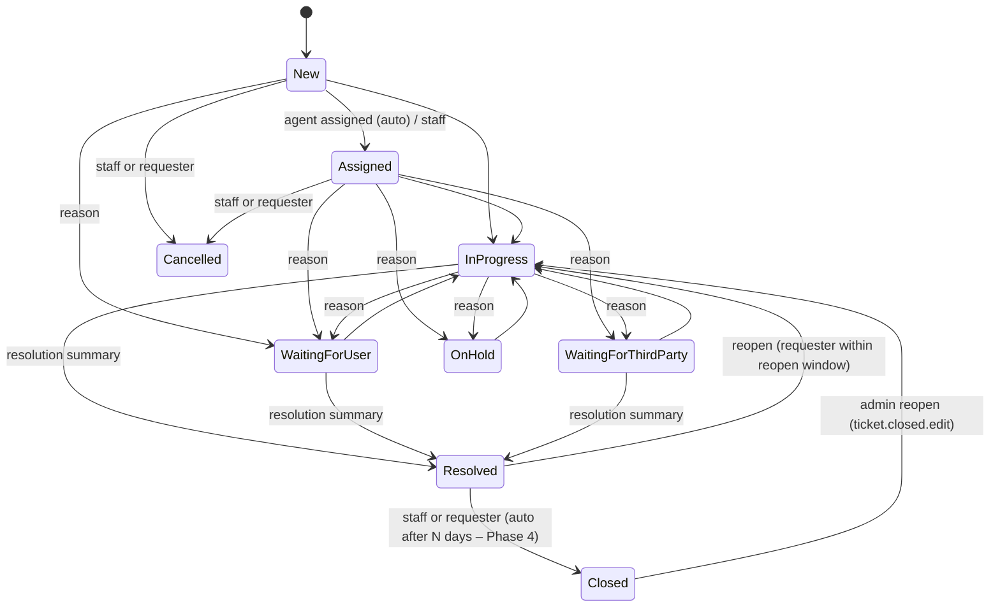
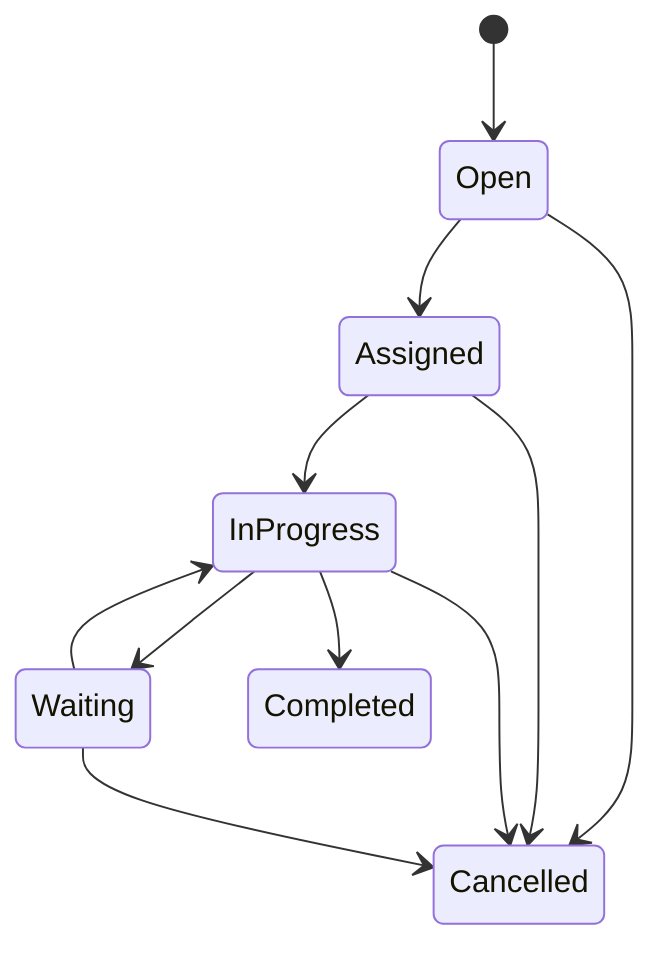

# 05 · Ticket & Task Workflows

All statuses, transitions and their permissions are **data** (Admin → Configuration → Status / Workflow). Code only relies on each status's **kind**:

| Kind | Meaning | System behaviour |
|---|---|---|
| `NEW` | logged, not yet worked | initial status (`isDefault`); first staff transition out of NEW sets *first response* |
| `OPEN` | being worked | — |
| `WAITING` | blocked on someone | **reason required**; `pausesSla` per status (Waiting for User / Third Party pause by default) |
| `RESOLVED` | fix delivered | **resolution summary required**; blocked while *required* tasks are open; sets `resolvedAt` |
| `CLOSED` | confirmed / auto-closed | read-only unless `ticket.closed.edit`; sets `closedAt` |
| `CANCELLED` | withdrawn | read-only unless `ticket.closed.edit` |

## Default ticket workflow (seeded)

## Transition validation (server-side, `src/server/domain/workflow.ts`)
1. Target ≠ current status, target active.
2. A `WorkflowTransition(from, to)` exists.
3. Actor is **support staff who can work the ticket** and holds the transition's `requiredPermission`, **or** is the **requester** and the transition is `requesterAllowed` (reopen additionally limited by `tickets.reopenWindowDays`).
4. From CLOSED/CANCELLED requires `ticket.closed.edit`.
5. WAITING-kind or `requiresReason` status → reason; `requiresComment` transition → comment.
6. RESOLVED → resolution summary and zero open required tasks.
7. Optimistic concurrency: the update is conditional on the status read (`updateMany where statusId = from`), so two agents cannot race.
8. Writes `TicketHistory` (STATUS_CHANGED / REOPENED with reason), `AuditLog`, notifications (requester + assignee).

## Routing on creation
`resolveRouting()` precedence: **active routing rules** (ascending order; match category/subcategory + optional priority / branch / department) → **subcategory default team** → **main category default team** → **fallback team** setting. Writes `TicketAssignment(type=AUTO)` and notifies the team (or the rule's agent).

## Assignment changes
| Type | When | Rules |
|---|---|---|
| ASSIGN | first agent on the ticket | `ticket.assign`; agent must be active member of the team; NEW → configured "assigned" status if the workflow allows |
| REASSIGN | agent changes within team | same |
| TRANSFER | owner team changes | + `ticket.transfer`; reason mandatory |
| ESCALATE | Phase 4 (SLA) / manual | `ticket.escalate` |
| AUTO | routing on create | system |
Each change records previous/new team, previous/new agent, who, when, reason.

## Task workflow (Phase 2 — schema in place)

- A ticket keeps one **owner team + responsible agent**; other teams contribute via tasks (`TicketTask.teamId`) and appear as *supporting teams*, gaining read access through the data scope — no ticket transfer needed.
- Each task: own team/agent, priority, start/due date, required/optional flag, attachments, history (`TaskHistory`, `TaskAssignment`).
- Ticket progress = completed required tasks / required tasks; RESOLVED blocked until all required tasks are COMPLETED (already enforced by the workflow validator).
- Views: My Tasks (agent), Team Tasks (lead), All Tasks (admin), Overdue highlighting (`dueDate < now` and not terminal).
