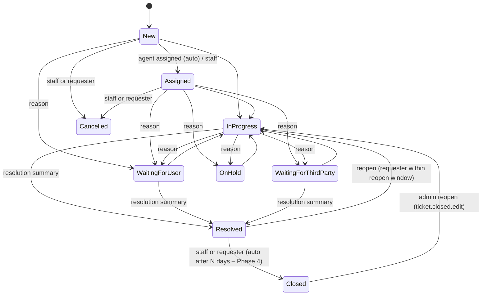
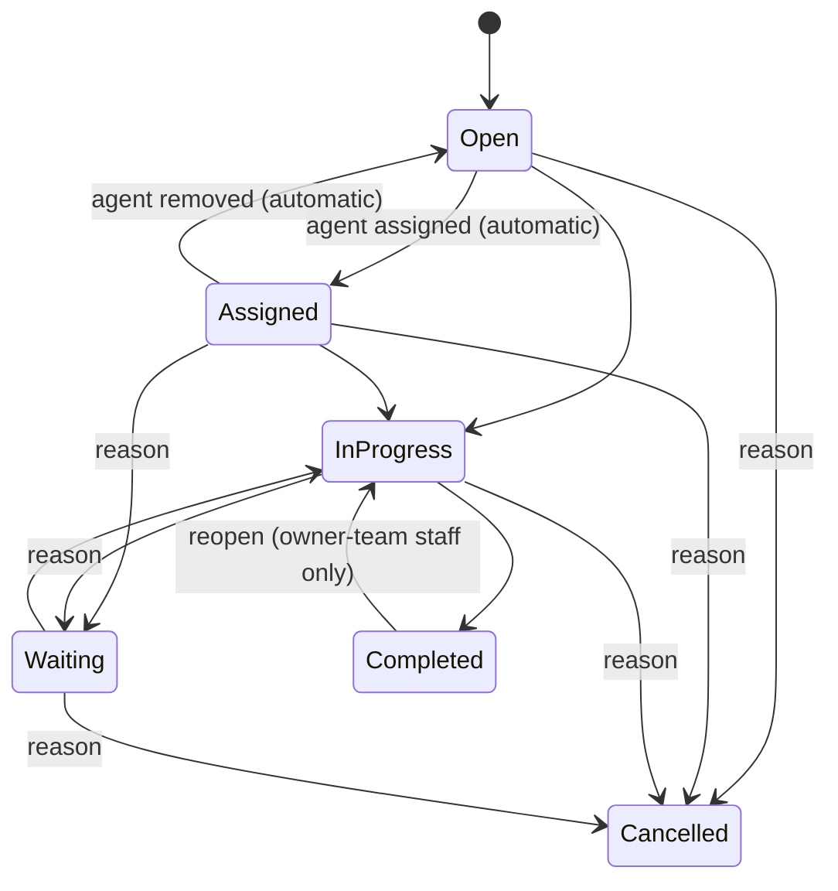

# 05 · Ticket & Task Workflows

All statuses, transitions and their permissions are **data** (Admin → Configuration → Status / Workflow). Code only relies on each status's **kind**:

| Kind | Meaning | System behaviour |
|---|---|---|
| `NEW` | logged, not yet worked | initial status (`isDefault`); first staff transition out of NEW sets *first response* |
| `OPEN` | being worked | — |
| `WAITING` | blocked on someone | **reason required**; `pausesSla` per status (Waiting for User / Third Party pause by default) |
| `RESOLVED` | fix delivered | **resolution summary required**; blocked while *required* tasks are open; sets `resolvedAt` |
| `CLOSED` | confirmed / auto-closed | read-only unless `ticket.closed.edit`; sets `closedAt` |
| `CANCELLED` | withdrawn | read-only unless `ticket.closed.edit` |

## Default ticket workflow (seeded)

## Transition validation (server-side, `src/server/domain/workflow.ts`)
1. Target ≠ current status, target active.
2. A `WorkflowTransition(from, to)` exists.
3. Actor is **support staff who can work the ticket** and holds the transition's `requiredPermission`, **or** is the **requester** and the transition is `requesterAllowed` (reopen additionally limited by `tickets.reopenWindowDays`).
4. From CLOSED/CANCELLED requires `ticket.closed.edit`.
5. WAITING-kind or `requiresReason` status → reason; `requiresComment` transition → comment.
6. RESOLVED → resolution summary and zero open required tasks.
7. Optimistic concurrency: the update is conditional on the status read (`updateMany where statusId = from`), so two agents cannot race.
8. Writes `TicketHistory` (STATUS_CHANGED / REOPENED with reason), `AuditLog`, notifications (requester + assignee).

## Routing on creation
`resolveRouting()` precedence: **active routing rules** (ascending order; match category/subcategory + optional priority / branch / department) → **subcategory default team** → **main category default team** → **fallback team** setting. Writes `TicketAssignment(type=AUTO)` and notifies the team (or the rule's agent).

## Assignment changes
| Type | When | Rules |
|---|---|---|
| ASSIGN | first agent on the ticket | `ticket.assign`; agent must be active member of the team; NEW → configured "assigned" status if the workflow allows |
| REASSIGN | agent changes within team | same |
| TRANSFER | owner team changes | + `ticket.transfer`; reason mandatory |
| ESCALATE | Phase 4 (SLA) / manual | `ticket.escalate` |
| AUTO | routing on create | system |
Each change records previous/new team, previous/new agent, who, when, reason.

## Task workflow (Phase 2 — implemented)
Task statuses are fixed by the specification (enum); ticket statuses remain fully configurable.

Implemented in `src/server/domain/task-workflow.ts` (pure, unit-tested) and `src/server/services/tasks.ts`.

**Multiple teams without transferring the ticket**
- A ticket keeps one **main owner team + responsible agent**. Other teams contribute through **tasks**; creating/moving a task to a non-owner team automatically adds it as a **supporting team** (also manageable manually from the ticket's *Teams* card; removal is blocked while that team has open tasks).
- Supporting/task teams gain read access to the ticket through the data scope. Vendor users additionally see **only their own team's tasks** (others are counted, not shown), and task events of other teams are filtered out of their timeline.

**Rules**
| Action | Who |
|---|---|
| Create task | `task.manage` + can work the ticket (owner team, responsible agent, admins) |
| Update fields / change status | `task.manage` + task team member, task assignee, owner-team staff or admins |
| Change required/optional, reopen completed | owner side only (not vendors / other teams) |
| Assign / reassign / move team | `task.assign` (leads, admins) who can work the ticket or lead the task's team; others may only **self-assign** within their own team. Moving teams needs a reason. Agent must be an active team member. |
| Requester | read-only: tasks, status, progress, history |

- Waiting / Cancelled need a reason; Completed sets `completedAt`; first move to In Progress sets `startDate`.
- Every change writes `TaskHistory`, a summarised `TicketHistory` entry (unified ticket timeline), `AuditLog` (`TASK_CREATED` / `TASK_ASSIGNED` / `TASK_UPDATED`) and notifications (task assignee, ticket's responsible agent; team on creation; "all required tasks done" to the responsible agent).
- **Resolution gating**: a ticket cannot be RESOLVED while any **required** task is not Completed/Cancelled; the resolve dialog lists the blocking tasks.
- Tasks of closed/cancelled tickets are frozen (except `ticket.closed.edit`).
- Views: *My Tasks*, *Team Tasks*, *Overdue Tasks* (support staff), *All Tasks* (`ticket.read.all`) with search, filters, sorting, pagination; overdue rows highlighted.

## Ticket edits & escalation (Phase 2)
- Staff who can work a ticket edit subject, description, category/subcategory (required-field rules re-checked), priority, branch/location, contact, asset, affected system/users, confidential flag. One history row per field; `CATEGORY_CHANGED` / `PRIORITY_CHANGED` / `TICKET_UPDATED` audit; SLA due dates recomputed (from creation time) when category or priority changes.
- **Escalate** (`ticket.escalate`, team leads/admins): optionally move to another team and/or **raise** priority, with mandatory reason; recorded as `TicketAssignment(type=ESCALATE)`; the target team's leads are notified.

## Ticket communication (Phase 3)
- **Chat inside the ticket** (Chat tab): public messages (requester ↔ support, multiple agents and teams) and **internal notes** (staff only, amber styling, never exposed to requesters/vendors).
- Text, images (inline preview) and file attachments; timestamps, sender and role; "Seen by …" read receipts; history with "Load earlier"; in-conversation search with highlighting.
- **Unread**: per-ticket unread counters (Chat tab badge, 💬 badge in ticket lists, Support Chat / Messages inbox, sidebar badge); opening the conversation marks it read.
- **Automation**: the first public reply by support staff sets *first response* (SLA); a requester reply to a WAITING ticket moves it to the configured status (default *In Progress*, only if the workflow allows that transition; setting `workflow.requesterReplyStatusCode`).
- **Notifications**: in-app, realtime (toast + live bell). Chat notifications are coalesced per ticket while unread. Recipients: staff public reply → requester; requester message → responsible agent + active task assignees (or owner team if unassigned); internal note → responsible agent + active task assignees (internal users only). Admins can switch event types off in *Notification Settings*.
- Every message is audited (`CHAT_MESSAGE` / `INTERNAL_NOTE` with excerpt, `ATTACHMENT_ADDED`).

## SLA (Phase 4)
**Profile selection**: subcategory → category → owner team → default profile; targets per **priority** (response, resolution, business-hours or 24×7). Defaults: P1 15 min / 4 h (24×7), P2 30 min / 8 h (24×7), P3 4 h / 3 business days, P4 1 business day / 5 business days — all editable (Admin → SLA Profiles → Targets).

**Clocks**
| Clock | Starts | Met when | Pauses |
|---|---|---|---|
| Response | ticket creation | first staff action out of NEW, assignment of an agent, or first public staff chat reply | while in a pause status (until met) |
| Resolution | ticket creation | ticket reaches a RESOLVED-kind status (reopen continues the clock) | while in a pause status; stopped while resolved |

- **Pause conditions** are per profile (`pauseStatusCodes`, default *Waiting for User*, *Waiting for Third Party*); if a profile lists none, each status's own *Pauses SLA* flag applies. Paused time is measured in business minutes and added to the due dates on resume.
- **States**: On Track → Warning (≥ profile warning %, default 75%) → Breached (≥ 100%); Paused; Completed Within SLA / Completed Late.
- **Business hours**: per calendar timezone and weekly windows (split shifts supported); holidays excluded; 24×7 targets ignore the calendar.

**SLA job (every minute)**
1. Warning → `SLA_WARNING` notification (responsible agent or owner team + team leads), `SlaEvent WARNING`, audit.
2. Breach → `responseBreached` / `resolutionBreached` flags, `SLA_BREACHED` notification, `SlaEvent BREACHED`, audit.
3. Escalation rules (profile, clock, at %): notify owner-team leads and/or transfer to an escalation team (`TicketAssignment ESCALATE`, actor System). Each rule fires once per ticket.
4. Overdue tasks → `TASK_OVERDUE` once per task.
5. Auto-close resolved tickets after `tickets.autoCloseResolvedDays` (0 = off), via the workflow's Resolved → Closed transition.

Ops: "Run SLA check now" on the SLA Profiles page; `pnpm jobs:run` for external schedulers; `JOBS_ENABLED=false` disables the in-process runner.

## Dashboards & reports (Phase 5)
| Dashboard | Who | Highlights |
|---|---|---|
| Management | management viewers, admins | 12 KPIs, created-vs-resolved trend, SLA compliance trend, status/priority/category/subcategory/team/branch/department breakdowns, aging |
| Team | team leads (admins pick a team) | backlog, unassigned, overdue, breached, member workload, aging, open SLA states, oldest tickets |
| My work | agents / leads | my assigned, in progress, waiting, overdue, breached, open & overdue tasks, resolved in period, my compliance, next due |
| SLA | support & management | resolution/response compliance, compliance trend, within/outside SLA per period, by priority, by team (lowest first), breached open list |
| Ticket aging | support & management | 0–1 / 2–3 / 4–7 / 8–14 / >14 days × priority, drill-down per bucket, oldest tickets |
| Workload | leads & management | per agent: assigned, in progress, waiting, open tasks, overdue tasks, completed, avg resolution; per team: open, unassigned, overdue, breached, completed |

Filters (URL state, shared by all dashboards and reports): date range presets / custom, company, department, branch, team, category, subcategory, priority, status, agent. Rows in tables link to the filtered ticket list (drill-down), where the dashboard filters appear as removable chips.

Reports: ticket detail, SLA compliance, agent performance, team performance, category summary — preview (50 rows) and CSV export.

## Major incidents & branch impact (Phase 6A)
- **Impact** (any staff who can work the ticket, also selectable on create): scope `Single user | Single branch | Multiple branches | Company-wide | Multiple companies`, impacted branches (single = exactly 1, multiple = ≥ 2; single-branch on create defaults to the ticket branch), approximate affected users. History + audit.
- **Declare** (`incident.manage`): requires impact; not for confidential tickets, linked children or closed tickets. Sets status *Investigating* and posts the first communication. Notifies owner/supporting teams, leads, requesters; Teams card.
- **Updates**: *Investigating → Identified → Monitoring* with a public message — the communication log; requesters of the incident and every linked ticket are notified.
- **Linking**: child tickets link to one active incident; a major incident or a ticket with children cannot become a child (no cycles).
- **Resolve**: final *Resolved* update; optional cascade resolves each active child where (a) a workflow transition to a Resolved-kind status exists from its current status, (b) no required task is open, (c) no approval is pending. Skipped children are reported with the reason.
- **Known-issues banner**: employees whose branch (or company, for company-wide) is impacted see subject, status and the latest update; *I'm affected too* creates one linked child ticket per user.

## Knowledge base (Phase 6B)
`DRAFT → PUBLISHED → ARCHIVED (→ DRAFT)`. Writers (`kb.write`) create and edit drafts; publishers (`kb.publish`) publish/archive and edit published articles (optimistic version check, audited change note). *Create knowledge article* on a resolved/closed (non-confidential) ticket drafts a support-only Troubleshooting article (Symptoms / Solution) linked to the ticket. Search = PostgreSQL full text (`simple`, GIN) OR substring match (Thai, partial words); title hits rank first. The create-ticket form suggests articles as the subject is typed; *This solved my problem* records a helpful vote + `KB_DEFLECTED` audit without creating a ticket.

## Approval workflow (Phase 6C)
1. On create, the **subcategory policy wins over the main-category policy**. Each step's approver: the requester's manager or a specific user; a fallback approver is used when the manager is missing/inactive or would be the requester. No resolvable approver → the ticket is not created (clear message).
2. The chain is snapshotted (`TicketApproval`): step 1 *Pending*, later steps *Waiting*. `approvalStatus = PENDING`; SLA clocks pause (event detail `approval`).
3. While pending: only cancellation is possible (cancelling withdraws the requests); assignment and chat stay available; no automatic status moves; no SLA resume from any path.
4. **Approve** → next step becomes Pending (approver notified) or the ticket is *Approved*: SLA resumes (paused time added, unless the current status itself pauses), owner team + requester notified.
5. **Reject** (comment required) → *Rejected*; the ticket moves to a Cancelled-kind status if the workflow has that transition; requester + staff notified.
Seeded: Hardware Request, Access Request, New Equipment → line manager (fallback: System Admin).

## Integrations (Phase 6D)
- **Outbox**: Teams cards are written in the same transaction as the business change, then delivered by the job runner (lease-protected). Retries: 1, 2, 4, 8, 16 min (or Retry-After), max 6 attempts; 4xx (except 408/429) is permanent. Admins can retry from the delivery log.
- **Teams events** (configurable): new ticket for a team, transfer to a team, SLA breach, major incident declared/updated/resolved.
- **Graph sync**: per tenant, every *N* hours (default 24) or *Sync now*; see the security register for the rules.
- **Power BI**: `GET /api/bi/v1/{tickets|tasks|sla-events|teams|categories|priorities|statuses|branches|departments}`; `$top` ≤ 5000, `$skip`, `modifiedSince`; `@odata.nextLink` for paging.

## Languages (Phase 8)
- Locale per request: signed-in user's saved language → `NEXT_LOCALE` cookie → Thai. No language segment in URLs.
- Texts that belong to a viewer are rendered when shown (pages, notifications, toasts, CSV exports). Texts without a viewer use the system setting `i18n.defaultLocale` (Teams channel cards).
- Stored business data is not translated: ticket history keeps the status names valid at the time; subjects, descriptions, chat and notes stay as written.
- Approval step names are snapshotted with their Thai name (`TicketApproval.stepNameTh`) when the ticket is created.

## Chat-first service (Phase 9)
- A chat case is a ticket with `channel = CHAT`; the guided start collects category → subcategory → branch → required fields → details, then calls the normal ticket creation. The details and files become the first chat message.
- Shared queue: `ticketScopeWhere` adds *unclaimed open non-confidential chat cases* for non-vendor actors with `chat.queue`. Claiming uses the same assignment write as *Assign* (`commitAssignment`) with an atomic "still unclaimed" check; the owner team becomes the claimer's team (chosen when the agent is in several teams).
- Realtime room `chat-queue` (signals `chat:new`, `chat:claimed`, `chat:updated`) keeps consoles and badges current; ticket actions (status, assign, edit, escalate) signal `chat:updated`.
- Per-user settings live in `UserPreference` (key `chat.filter`).

