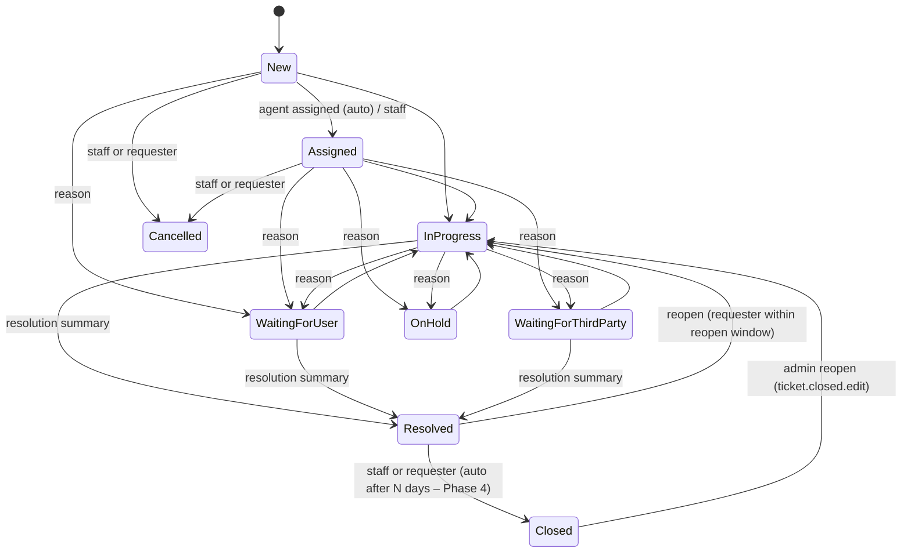
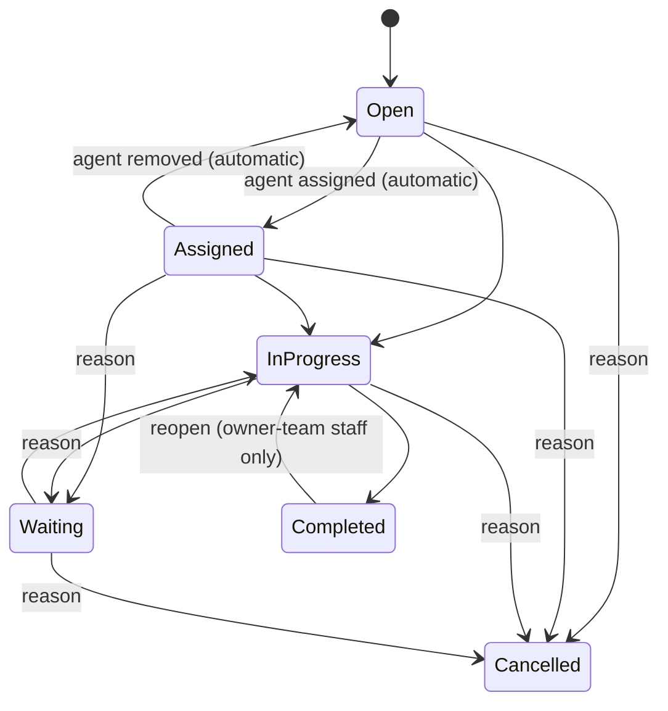

# 05 · Ticket & Task Workflows

All statuses, transitions and their permissions are **data** (Admin → Configuration → Status / Workflow). Code only relies on each status's **kind**:

| Kind | Meaning | System behaviour |
|---|---|---|
| `NEW` | logged, not yet worked | initial status (`isDefault`); first staff transition out of NEW sets *first response* |
| `OPEN` | being worked | — |
| `WAITING` | blocked on someone | **reason required**; `pausesSla` per status (Waiting for User / Third Party pause by default) |
| `RESOLVED` | fix delivered | **resolution summary required**; blocked while *required* tasks are open; sets `resolvedAt` |
| `CLOSED` | confirmed / auto-closed | read-only unless `ticket.closed.edit`; sets `closedAt` |
| `CANCELLED` | withdrawn | read-only unless `ticket.closed.edit` |

## Default ticket workflow (seeded)

## Transition validation (server-side, `src/server/domain/workflow.ts`)
1. Target ≠ current status, target active.
2. A `WorkflowTransition(from, to)` exists.
3. Actor is **support staff who can work the ticket** and holds the transition's `requiredPermission`, **or** is the **requester** and the transition is `requesterAllowed` (reopen additionally limited by `tickets.reopenWindowDays`).
4. From CLOSED/CANCELLED requires `ticket.closed.edit`.
5. WAITING-kind or `requiresReason` status → reason; `requiresComment` transition → comment.
6. RESOLVED → resolution summary and zero open required tasks.
7. Optimistic concurrency: the update is conditional on the status read (`updateMany where statusId = from`), so two agents cannot race.
8. Writes `TicketHistory` (STATUS_CHANGED / REOPENED with reason), `AuditLog`, notifications (requester + assignee).

## Routing on creation
`resolveRouting()` precedence: **active routing rules** (ascending order; match category/subcategory + optional priority / branch / department) → **subcategory default team** → **main category default team** → **fallback team** setting. Writes `TicketAssignment(type=AUTO)` and notifies the team (or the rule's agent).

## Assignment changes
| Type | When | Rules |
|---|---|---|
| ASSIGN | first agent on the ticket | `ticket.assign`; agent must be active member of the team; NEW → configured "assigned" status if the workflow allows |
| REASSIGN | agent changes within team | same |
| TRANSFER | owner team changes | + `ticket.transfer`; reason mandatory |
| ESCALATE | Phase 4 (SLA) / manual | `ticket.escalate` |
| AUTO | routing on create | system |
Each change records previous/new team, previous/new agent, who, when, reason.

## Task workflow (Phase 2 — implemented)
Task statuses are fixed by the specification (enum); ticket statuses remain fully configurable.

Implemented in `src/server/domain/task-workflow.ts` (pure, unit-tested) and `src/server/services/tasks.ts`.

**Multiple teams without transferring the ticket**
- A ticket keeps one **main owner team + responsible agent**. Other teams contribute through **tasks**; creating/moving a task to a non-owner team automatically adds it as a **supporting team** (also manageable manually from the ticket's *Teams* card; removal is blocked while that team has open tasks).
- Supporting/task teams gain read access to the ticket through the data scope. Vendor users additionally see **only their own team's tasks** (others are counted, not shown), and task events of other teams are filtered out of their timeline.

**Rules**
| Action | Who |
|---|---|
| Create task | `task.manage` + can work the ticket (owner team, responsible agent, admins) |
| Update fields / change status | `task.manage` + task team member, task assignee, owner-team staff or admins |
| Change required/optional, reopen completed | owner side only (not vendors / other teams) |
| Assign / reassign / move team | `task.assign` (leads, admins) who can work the ticket or lead the task's team; others may only **self-assign** within their own team. Moving teams needs a reason. Agent must be an active team member. |
| Requester | read-only: tasks, status, progress, history |

- Waiting / Cancelled need a reason; Completed sets `completedAt`; first move to In Progress sets `startDate`.
- Every change writes `TaskHistory`, a summarised `TicketHistory` entry (unified ticket timeline), `AuditLog` (`TASK_CREATED` / `TASK_ASSIGNED` / `TASK_UPDATED`) and notifications (task assignee, ticket's responsible agent; team on creation; "all required tasks done" to the responsible agent).
- **Resolution gating**: a ticket cannot be RESOLVED while any **required** task is not Completed/Cancelled; the resolve dialog lists the blocking tasks.
- Tasks of closed/cancelled tickets are frozen (except `ticket.closed.edit`).
- Views: *My Tasks*, *Team Tasks*, *Overdue Tasks* (support staff), *All Tasks* (`ticket.read.all`) with search, filters, sorting, pagination; overdue rows highlighted.

## Ticket edits & escalation (Phase 2)
- Staff who can work a ticket edit subject, description, category/subcategory (required-field rules re-checked), priority, branch/location, contact, asset, affected system/users, confidential flag. One history row per field; `CATEGORY_CHANGED` / `PRIORITY_CHANGED` / `TICKET_UPDATED` audit; SLA due dates recomputed (from creation time) when category or priority changes.
- **Escalate** (`ticket.escalate`, team leads/admins): optionally move to another team and/or **raise** priority, with mandatory reason; recorded as `TicketAssignment(type=ESCALATE)`; the target team's leads are notified.
